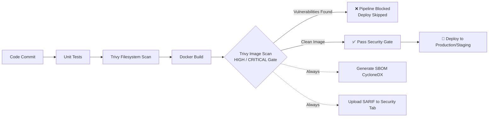

# DevSecOps Case Study: Shift-Left Security with Trivy

Alternative DevOps tool: **Trivy** (Aqua Security)  
Pipeline Stage: **Security / DevSecOps (Shift-Left Vulnerability Scanning)**

A containerized Python Flask service running through a complete GitHub Actions CI/CD pipeline:
```
git commit -> Unit Tests -> Trivy Filesystem Scan -> Docker Build -> Trivy Image Scan (Security Gate) -> SARIF & SBOM Generation -> Deploy
```

---

## 📁 Repository Layout

| Path | Purpose |
|---|---|
| `app/`, `tests/` | Lightweight demo Flask application and unit tests |
| `Dockerfile`, `requirements.txt` | **Secure / Hardened** version (minimal Debian/Alpine base, non-root user, pinned modern packages) |
| `insecure/` | **"Before"** Dockerfile & dependencies (outdated base image, root user, vulnerable packages) |
| `.github/workflows/devsecops.yml` | GitHub Actions pipeline with Trivy security gate, SARIF upload, and SBOM artifact generation |
| `local_scan.ps1` | Windows PowerShell script to run scans locally using Docker or Trivy CLI |
| `local_scan.sh` | Linux/macOS/Git Bash script to run scans locally |
| `trivy.yaml` | Trivy scan configuration (severity thresholds, unfixed CVE suppression) |
| `.trivyignore` | Whitelist for accepted-risk or false-positive CVEs |

---

## 🚀 How the Pipeline Works



1. **Stage 1: Filesystem Scan (`trivy fs`)**
   Scans source code, dependency manifests (`requirements.txt`), IaC configuration (`Dockerfile`), and detects exposed hardcoded secrets or misconfigurations.
2. **Stage 2: Image Scan Gate (`trivy image --exit-code 1`)**
   Scans the built container image layers (OS packages from Debian/Alpine + application wheels). If any **HIGH** or **CRITICAL** severity vulnerabilities with available fixes are discovered, Trivy exits with code `1`, immediately halting the pipeline before deployment.
3. **Stage 3: Compliance & Transparency (SARIF + SBOM)**
   - **SARIF Report:** Standardized vulnerability report uploaded directly into the repository's GitHub **Security -> Code Scanning Alerts** tab.
   - **CycloneDX SBOM:** Software Bill of Materials cataloging every software package and version shipped inside the image for compliance and supply-chain auditing.

---

## 🧪 Demonstration Steps (Before & After)

### Scenario 1: Insecure Baseline (Pipeline Fails & Blocks Deploy)

Simulate introducing legacy code and an unhardened container:

**On Windows (PowerShell):**
```powershell
Copy-Item insecure\Dockerfile Dockerfile -Force
Copy-Item insecure\requirements.txt requirements.txt -Force
git add .
git commit -m "demo: introduce legacy dependencies and insecure base image"
git push
```

**On Linux / macOS / Git Bash:**
```bash
cp insecure/Dockerfile Dockerfile
cp insecure/requirements.txt requirements.txt
git add .
git commit -m "demo: introduce legacy dependencies and insecure base image"
git push
```

**What Happens:**
- Trivy detects numerous HIGH and CRITICAL vulnerabilities in the old Python 3.7 Debian Buster base image and outdated Flask/Werkzeug libraries.
- The **Trivy image scan (gate)** step fails with exit code 1.
- The `deploy` job is skipped.
- Inspect the findings in GitHub Actions console log and under **Security -> Code Scanning**.

---

### Scenario 2: Remediating Vulnerabilities (Pipeline Passes)

Restore the hardened, secure container configuration:

**On Windows (PowerShell):**
```powershell
git checkout HEAD~1 -- Dockerfile requirements.txt
git commit -m "fix: upgrade base image to Python 3.12 slim and pin secure dependencies"
git push
```

**On Linux / macOS / Git Bash:**
```bash
git checkout HEAD~1 -- Dockerfile requirements.txt
git commit -m "fix: upgrade base image to Python 3.12 slim and pin secure dependencies"
git push
```

**What Happens:**
- Minimal, modern `python:3.12-slim` base image replaces the bloated legacy image.
- Non-root user `appuser` prevents privilege escalation attacks.
- Dependencies upgraded to patched releases (`Flask 3.0.3`, `Gunicorn 22.0.0`).
- Trivy reports 0 HIGH/CRITICAL CVEs.
- All stages pass green, the `deploy` job executes, and the SBOM is published as a downloadable artifact.

---

## 💻 Running the Scans Locally

You do not need to install Trivy manually if you have Docker Desktop running—the scripts automatically use the official `aquasec/trivy` container!

### On Windows PowerShell:
```powershell
.\local_scan.ps1
```

### On Linux / macOS / Git Bash:
```bash
chmod +x local_scan.sh
./local_scan.sh
```

---

## 💡 Key DevSecOps Concepts for Review / Viva

1. **What is Shift-Left Security?**  
   Detecting security issues as early as possible in the software development lifecycle (during commit and CI) rather than auditing after code reaches production.
2. **What is an SBOM (Software Bill of Materials)?**  
   A formal, structured inventory of all software components, dependencies, and metadata inside a build artifact (generated here in CycloneDX JSON format). Required by modern security compliance frameworks (e.g. NIST, Executive Order 14028).
3. **What is SARIF?**  
   *Static Analysis Results Interchange Format*—a standard JSON-based format for static analysis and vulnerability tools to publish findings directly into platforms like GitHub Security.
4. **Why scan both Filesystem (`fs`) and Image (`image`)?**  
   `trivy fs` catches misconfigurations, secrets, and raw manifest issues in source control before burning compute building an image. `trivy image` inspects the final packaged container, catching hidden OS layer packages (apt/apk libraries) that manifests alone do not reveal.
